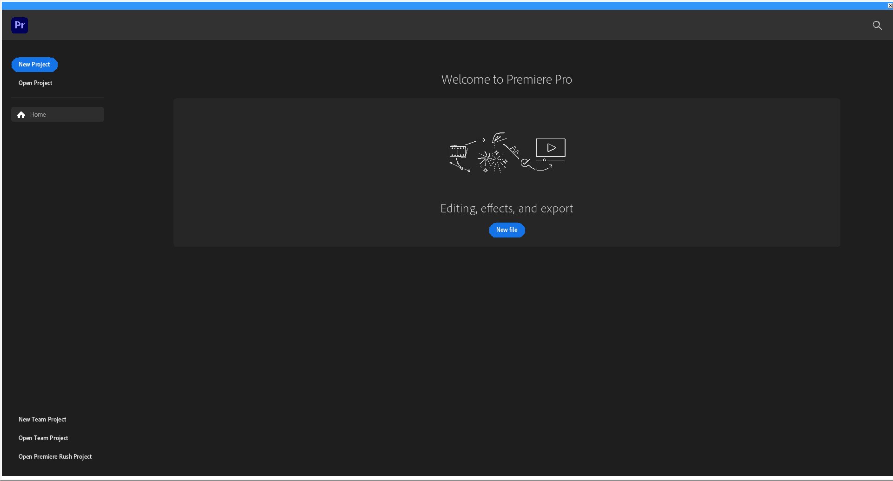
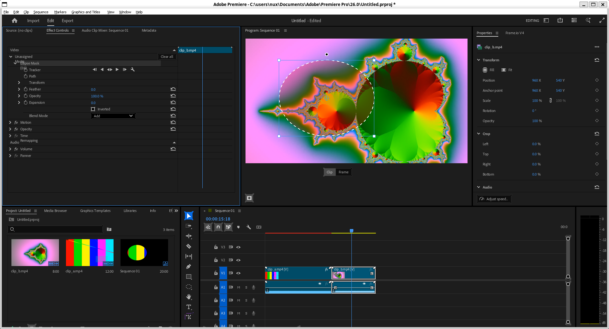
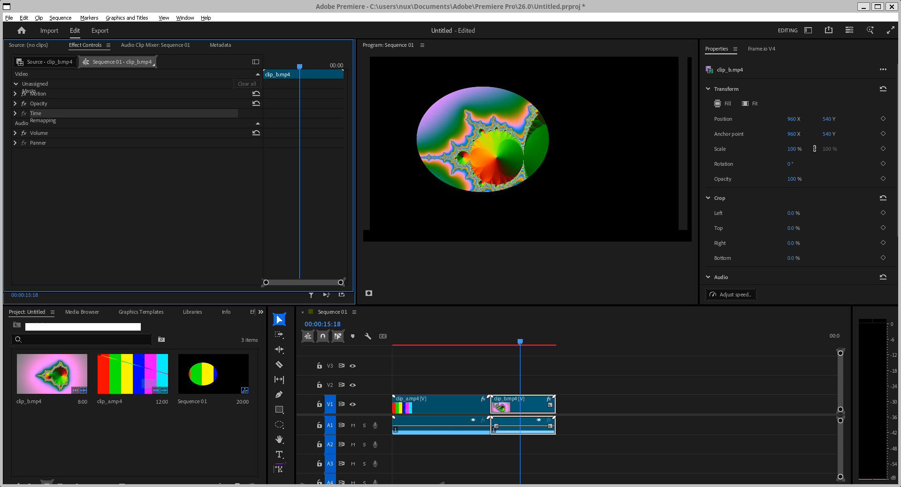
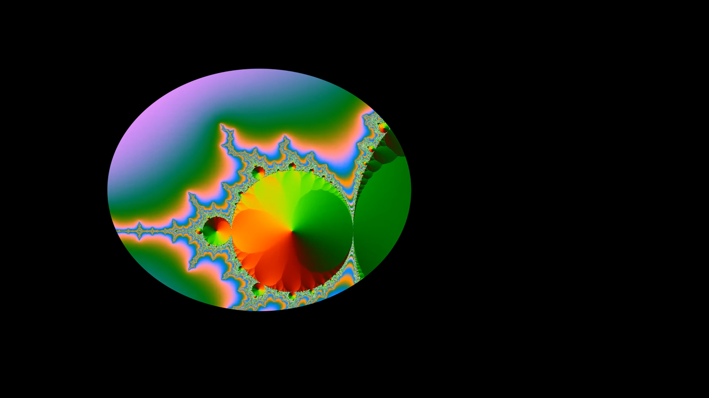
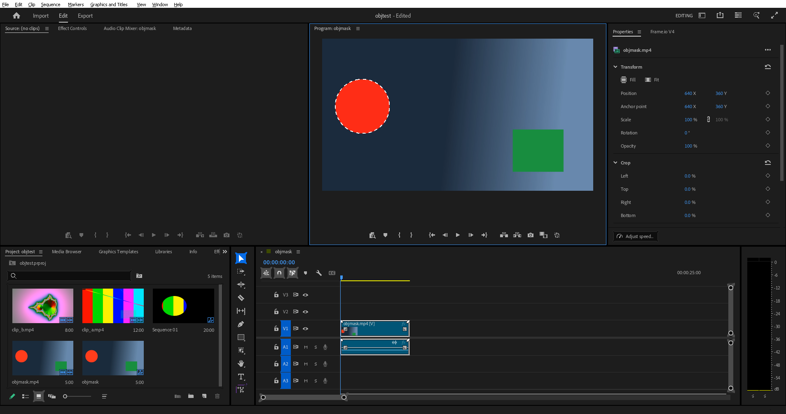
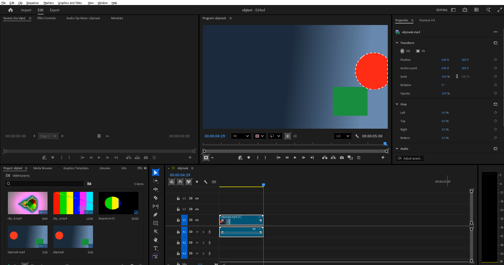
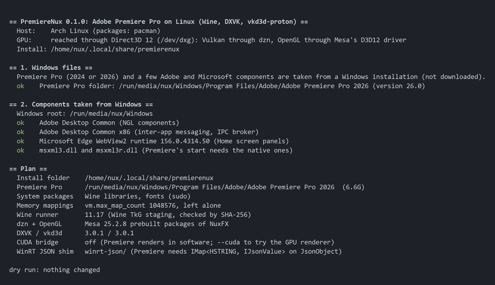
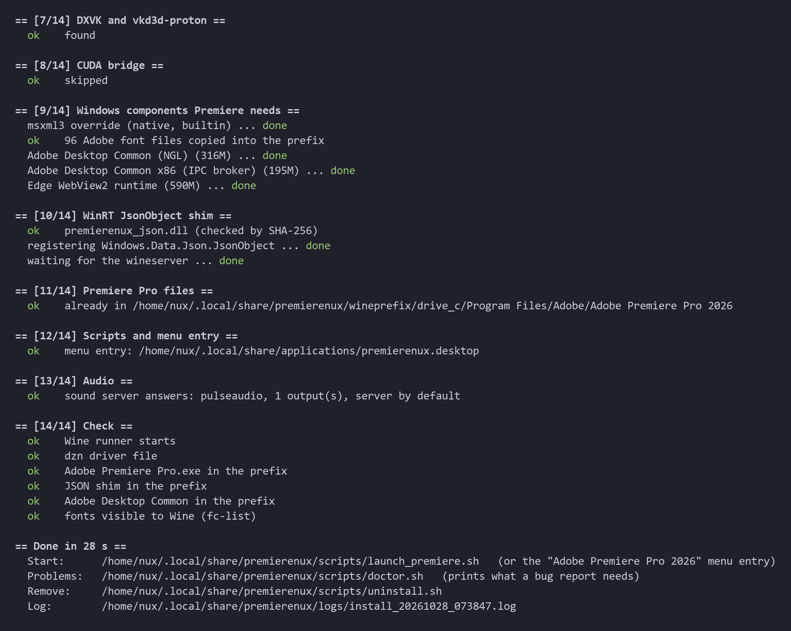
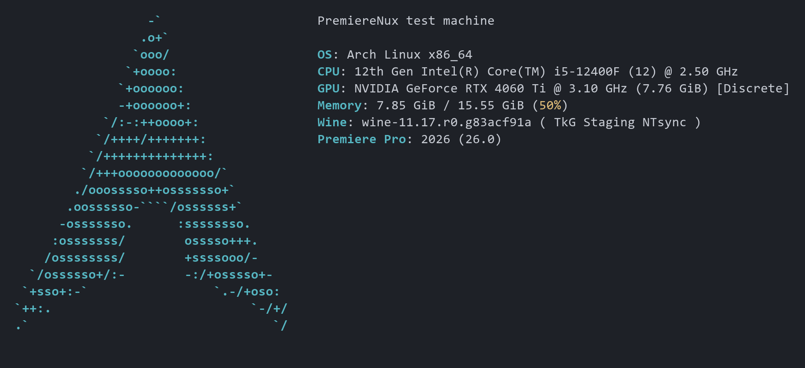

# PremiereNux

Install Adobe Premiere Pro 2024 or 2026 on Linux with one command.

PremiereNux sets up Wine (TkG staging) with DXVK and vkd3d-proton, and copies **your own** Premiere Pro
and the few Adobe and Microsoft components it needs from a Windows installation. It follows the
[MattKC forum guide](https://forum.mattkc.com/viewtopic.php?t=337) and adds what Premiere Pro 24.4 and 26.0 need beyond it.
The GPU stack is the one of [NuxFX](https://github.com/BuggingDev/NuxFX).

PremiereNux contains no Adobe software.

## Screenshots

Premiere Pro 2026 after the install. Every image shows the Premiere window only.



Edit workspace: an Ellipse Mask drawn in the Program monitor, its settings in Effect Controls.



After *Change to Opacity Mask*: the clip shows only inside the ellipse.



A frame of the exported H.264 file (1920x1080, 20 s): the mask is in the output.



Object Mask (the AI tool) on a test clip, a red disc that crosses a gradient. One click on the disc makes the mask:



After *Track forward* the mask sits on the disc at the last frame:



A frame of the exported H.264 file (2.4 s, 1280x720) with the mask changed to an Opacity Mask and Black & White applied:
only the disc is left, in grey, in the middle of the frame.


The installer (`./install.sh --dry-run` shows the plan and changes nothing):



The end of a second run, with everything already installed (finished parts are skipped):



The test machine (`fastfetch`):



## Install

```sh
git clone https://github.com/BuggingDev/PremiereNux.git
cd PremiereNux
./install.sh
```

The installer asks where the Windows files are, shows the plan, asks once, then installs without further input
(about 15 minutes, most of it downloads and copying; about 15 GB of disk). `sudo` is used for packages and for
`vm.max_map_count`. Run it again at any time: finished parts are skipped.

Start Premiere with its menu entry or `~/.local/share/premierenux/scripts/launch_premiere.sh`. With several Premiere
versions on the Windows side the installer takes the 2024 one; for 2026 run
`./install.sh --premiere-dir "/run/media/you/Windows/Program Files/Adobe/Adobe Premiere Pro 2026"` (the folder keeps
its name in the prefix, because Premiere's own data holds that path). A later install of another version moves the
menu entry and `launch_premiere.sh` to it; `PP_DIR=<folder in the prefix> launch_premiere.sh` starts the other one.

Requirements: x86_64 Linux with a Vulkan 1.3 capable GPU driver, an X11 or XWayland session, a sound server (PipeWire
with `pipewire-pulse`, or PulseAudio), `sudo`, `curl`, `git`.

If something goes wrong, `~/.local/share/premierenux/scripts/doctor.sh` prints what a bug report needs (installation,
Wine, graphics route, sound server, fonts, last run); it changes nothing. `scripts/uninstall.sh` removes the install
folder, the menu entry and the settings; files that Premiere's user saved inside the prefix (Documents, Desktop, ...)
are moved to `~/PremiereNux-user-files-<time>/` first. Windows files and system packages are never touched.

### The Windows files

Premiere Pro's installer does not run under Wine, so Premiere comes from a Windows installation: install Premiere Pro
2024 or 2026 with Creative Cloud on a Windows PC or in a VM, then make these folders available to Linux. Keep the
Windows folder names.

```
Program Files/Adobe/Adobe Premiere Pro 2026   (or 2024)
Program Files/Common Files/Adobe/Premiere Pro/26.0/<id>/ObjectMask   (2026 only: the models of Object Mask)
Program Files/Common Files/Adobe/Adobe Desktop Common
Program Files (x86)/Common Files/Adobe/Adobe Desktop Common
Program Files (x86)/Microsoft/EdgeWebView/Application/<version>
Windows/System32/msxml3.dll  msxml3r.dll          (and the same two in Windows/SysWOW64)
Windows/Fonts/                                    (the Adobe*, Minion*, Myriad*, SourceCodePro*, SourceSansPro* files)
```

The easiest way is a mounted Windows partition (`/run/media/you/Windows`): the installer finds it. Otherwise copy
the folders into one directory with this layout and run `./install.sh --windows /path/to/that/directory`
(`--premiere-dir DIR` takes the Premiere folder alone; the other components are then missing and Premiere
may stay blank).

Options: `--yes`, `--windows DIR`, `--premiere-dir DIR`, `--home DIR`, `--no-packages`, `--cuda`, `--no-webview`,
`--no-dzn`, `--build-shim`, `--force`, `--dry-run`; `./install.sh --help`.

## What the installer does

| Step | Why |
|---|---|
| Wine TkG staging 11.17, DXVK 3.0.1, vkd3d-proton 3.0.1 (nvidia-libs 1.0.2 only with `--cuda`) | the NuxFX stack (it was tested with Wine 11.12; 11.17 is needed for Premiere Pro 2026: Wine 11.12's gdiplus replaces the family name of a private font by its full name, so 2026 stops with "FontFamilyNotFound Font: Adobe Clean"); every download is pinned by SHA-256 |
| On hosts that reach the GPU through Direct3D 12 (`/dev/dxg`): Mesa 25.2.8 dzn and OpenGL driver | prebuilt by NuxFX (Vulkan on Direct3D 12), with its patch 28 that Object Mask needs (the DirectML kernel of the tool crashed the Direct3D 12 driver of an NVIDIA GPU); a package of another build is replaced. Other hosts use their own Vulkan and OpenGL and skip this (`--no-dzn`) |
| Noto, DejaVu and Liberation fonts | Adobe's text engine throws `invalid map<K, T> key` and Premiere stops with "Initialization Failure" when Wine sees no system fonts |
| `libpulse`, `libasound`, `pactl` | Wine's sound drivers (PulseAudio protocol, ALSA) and the check of the sound server |
| Windows' `msxml3.dll` + `msxml3r.dll`, override `native,builtin` | the Win7 build that winetricks installs is unloaded again by Wine; Premiere then fails with "Error parsing properties list from memory" |
| `icuin71.dll`, `icuuc71.dll` also as `icuin.dll`, `icuuc.dll` | step 6 of the forum guide (the numbers differ per Premiere version) |
| Adobe's fonts (Myriad, Minion, ...) | Creative Cloud installs them system-wide on Windows |
| `winrt-json/premierenux_json.dll` | Wine's `Windows.Data.Json.JsonObject` has no `IMap<HSTRING, IJsonValue>`; Premiere asks for it at start, gets `E_NOINTERFACE` and ends with an access violation and empty windows. The shim adds the interface (LGPL, derived from Wine's `windows.web`) |
| `Adobe Desktop Common` (x64 and x86) | Adobe's NGL component needs its parts from this folder (else it falls back to Internet Explorer), and Adobe's inter-app messaging (Vulcan) needs `AdobeIPCBroker.exe`; without it the UXP panels, including the Home screen, never start |
| Microsoft Edge WebView2 runtime | the UXP panels run on it (placed where Adobe looks for it: `Program Files/Common Files/Adobe/Microsoft/EdgeWebView`) |
| `Common Files/Adobe/Premiere Pro/<version>/<id>/ObjectMask` (Premiere Pro 25 and newer) | the models of the Object Mask tool, 380 MB, copied into the prefix; without them the tool does nothing |
| Premiere Pro 2024 or 2026 | copied into the prefix |
| Audio check | looks for a sound server that answers and tells you when there is none (see Notes) |

## Notes

- The forum reports that newer 24.x builds need a Wine with a working `Windows.Data.Json.JsonObject`; the shim provides
  the one call Premiere makes.
- **Object Mask** (Premiere Pro 25 and newer) needs the models folder of the Windows installation (the installer copies
  it) and, on hosts that reach the GPU through Direct3D 12, the dzn with patch 28. The first hover after the start takes
  up to a minute, while the models load; then a click on an object makes the mask, and an *Object Mask Data Storage*
  notice asks to be confirmed once.
- **Sound** goes through the PulseAudio protocol (PulseAudio, or PipeWire with `pipewire-pulse`). Without a sound output
  Wine reports no device and Premiere stops at a box "No output device is available" that blocks its main window.
  A server whose socket exists but never answers does the same, so `launch_premiere.sh` asks the candidates in turn
  (`PULSE_SERVER` as set, libpulse's own search, the usual sockets) with a 4 s limit each and uses the first one that
  answers and has an output. When none does, it says so (`audio.log` in the run's log folder, and a desktop
  notification when `notify-send` exists) and Premiere shows its box: answer *No*, or tick *Don't show again*.
  `PRNUX_AUDIO_CHECK=0` turns the look-up off. Checked by recording the monitor of the output sink while Premiere
  played a clip with a 440 Hz tone: 12.5 s of tone with no gap, and Premiere still gets its audio device when
  `PULSE_SERVER` names a socket that never answers.
- Premiere renders in software. With the CUDA bridge installed (`--cuda`) it picks "Mercury Playback Engine GPU
  Acceleration (CUDA)": its kernels run (89 launches in a 5 s project, no CUDA error) but the Program monitor stays
  white, so the launcher hides the bridge (`PRNUX_DISABLE_CUDA=1` in `~/.config/premierenux/premierenux.conf`, written
  by the installer unless `--cuda` is given). Export uses the software H.264 encoder.
- Premiere 2026 starts in its *Learning* workspace; its Learn panel needs the internet and shows "Connection Issues"
  offline. *Window > Workspaces > Editing* gives the usual layout.
- After a window or panel is resized, or after a selection changes, parts of the interface can stay undrawn until the
  window is restored and maximized again. Some labels of Effect Controls overlap (for example "Masks" over "Motion").
- The preview of the Export workspace keeps showing a loading ring; the export itself is not affected.
- The shared plug-in folder `Program Files/Adobe/Common` (8 GB, shared with After Effects) is not copied.
- Logs: `~/.local/share/premierenux/logs/` (`install_*.log`, `premiere_*/err.log`). `PRNUX_WINEDEBUG=+seh` and
  other Wine debug channels work with `launch_premiere.sh`.
- `winrt-json/build.sh` rebuilds the shim (needs the MinGW-w64 cross compiler); `winrt-json/test_json.c` is its
  self-test (`wine test_json.exe`).

## Credits and license

[MattKC](https://forum.mattkc.com/viewtopic.php?t=337) and the forum thread's authors found the base recipe.
[NuxFX](https://github.com/BuggingDev/NuxFX) provides the GPU stack and the pinned downloads; this installer is derived
from its `install.sh` and `common.sh`. Wine, Wine-TkG (Kron4ek's builds), Mesa, DXVK, vkd3d-proton, nvidia-libs and
winetricks are by their authors, see [NOTICE](NOTICE).

PremiereNux is free software under the GNU General Public License, version 3 or later ([LICENSE](LICENSE)); the
JSON shim in `winrt-json/` is under the LGPL 2.1 or later because it derives from Wine.
Adobe and Premiere Pro are trademarks of Adobe. PremiereNux is not affiliated with Adobe. Running Premiere Pro
requires your own licence from Adobe.
